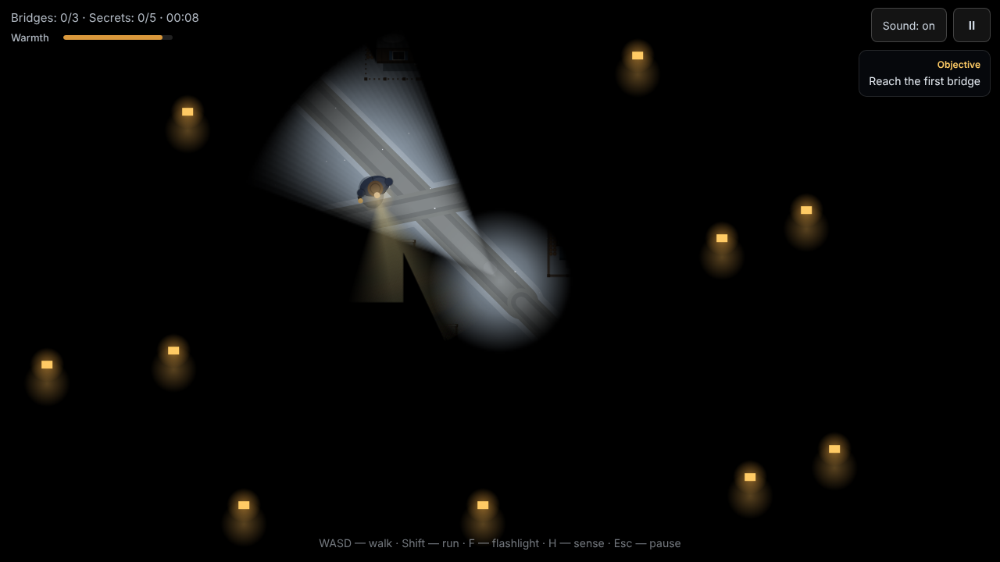
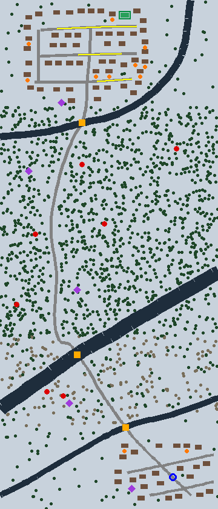

# Return Home · Дорога домой

A small atmospheric browser game. It is a winter night in a Siberian village, and you have to walk home in total darkness across three bridges without being caught.

**Play:** https://3dendroid.github.io/return-home/


## Story

A winter evening, around ten o'clock. You walk from Verkhneusinskoye to Nizhneusinskoye, two real villages on the Us river in Krasnoyarsk Krai. It is dark and freezing, and it is best if nobody sees you on the way. Home is the house with a green roof and two lit windows, in the far north-east corner of Nizhneusinskoye.

The map follows the real route on Google Maps: out of Verkhneusinskoye to the north-west, over a side channel, across the floodplain, over the Us, north through the forest, over the last channel and through the streets of Nizhneusinskoye to the far side of the village.



## How to play

| Key | Action |
|---|---|
| WASD / arrows | Walk |
| Shift | Run (faster, but enemies hear you from further away) |
| Hold mouse / finger | Walk towards the pointer (works on phones) |
| Esc | Pause: continue or restart |
| M | Sound on / off |

You only see what is inside your lantern's circle of light. Lit windows, other people's lanterns and wolves' eyes are visible from far away.

## What tries to stop you

- **Cold.** Warmth drains all the time. Lit windows warm you up; every bridge restores it fully. The wind on the Us bridge drains it four times faster and pushes you sideways.
- **Dogs** sit in village yards. They hear footsteps nearby and running from far away, then chase and bark.
- **Wolves** roam the forest and the floodplain. You only see their eyes. They are faster than walking but slower than running.
- **Grown-ups with lanterns** patrol village streets. Step into the beam and you are caught.
- **Rivers.** Walk into the water and you drown. Bridges have railings, so you cannot fall off them.

Enemies are placed randomly on every run.

## Secrets

Five things are hidden off the road, one in each part of the map: a mitten, a sled, a cedar cone, a coin and a whistle. A faint sparkle gives one away when you are close. The count is shown in the HUD and on the win screen.

The river is audible only near the water, and footsteps crunch on snow and knock on bridge planks. Bridges are checkpoints: if you lose, you go back to the last bridge you crossed.

## Difficulty

| | Easy | Normal | Hard |
|---|---|---|---|
| Cold | 0.7× | 1× | 1.4× |
| Light radius | 210 | 180 | 150 |
| Enemy speed | 0.85× | 1× | 1.1× |
| Enemy hearing | 0.8× | 1× | 1.25× |

## Leaderboard

Your best times are saved in the browser (`localStorage`), per difficulty. The copy of the game published as a claude.ai artifact also has a shared board for everyone it is shared with; on GitHub Pages the board is local to your device.

## Tech

- Plain HTML, CSS and JavaScript, no frameworks, no build step, no image or audio files.
- Rendering: Canvas 2D, top-down, with a radial "darkness" mask around the player.
- Sound: everything is synthesized with the Web Audio API — the river, footsteps in the snow, menu music, barking, howling, the chase theme, win and lose tunes.
- Languages: Russian and English, switchable in the menu.

```
index.html   page markup and menu
style.css    menu and HUD styles
game.js      map, enemies, audio, rendering, menu and leaderboard logic
docs/        screenshots and the map overview
```

### Run locally

```bash
git clone https://github.com/3dendroid/return-home.git
cd return-home
python3 -m http.server 8000
# open http://localhost:8000
```

Opening `index.html` directly from disk also works.



*Map overview without darkness: start (blue circle), bridges (orange), home (green frame), secrets (purple); red, orange and yellow mark one random set of wolves, dogs and lantern patrols.*

---

**RU.** Атмосферная браузерная игра: зимняя ночь, полная темнота, путь пешком из Верхнеусинского в Нижнеусинское (Красноярский край) через три моста. Мешают холод, собаки, волки, взрослые с фонарями и река. По пути спрятаны пять секретов. Карта повторяет реальный маршрут. Есть три уровня сложности, доска почёта, русский и английский язык.
