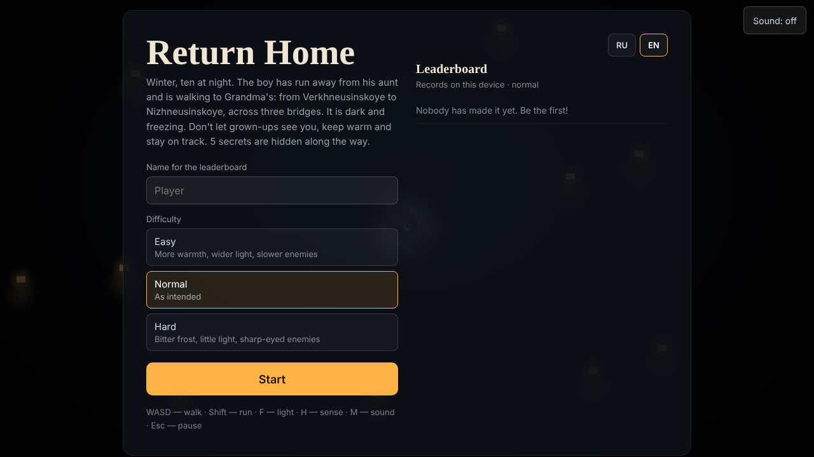
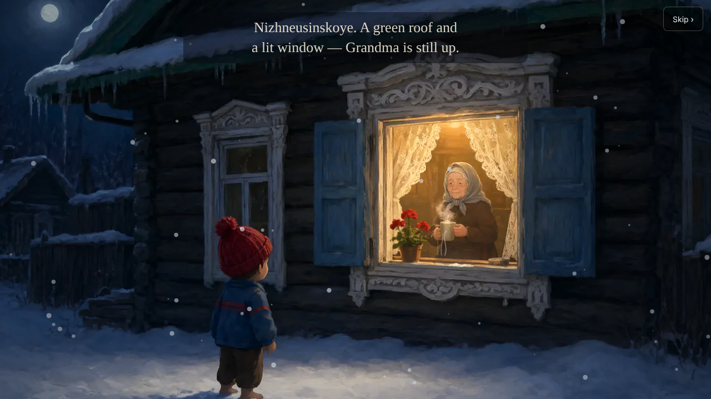
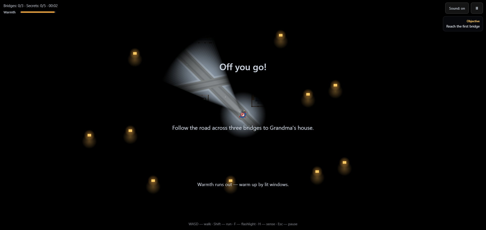

# Return Home · Дорога домой

A small atmospheric browser game based on a real childhood memory. It is a winter night in a Siberian village, and a five-year-old boy has to walk to his grandmother's house in total darkness, across three bridges, without being caught.

**Play:** https://3dendroid.github.io/return-home/ (desktop and phone)



## Story

Ten to ten on a winter night. The boy is at his aunt's house in Verkhneusinskoye and misses his grandmother, who lives in Nizhneusinskoye, almost three kilometres away. The door is locked, so he breaks the window, climbs out and runs off barefoot. Both villages are real, on the Us river in Krasnoyarsk Krai.

The map follows the real route on Google Maps: out of Verkhneusinskoye to the north-west, over a side channel, across the floodplain, over the Us, north through the forest, over the last channel and through the streets of Nizhneusinskoye to grandma's house with the green roof in the far north-east corner of the village.



## Cutscenes

The story is told in short scenes with captions. The pictures are illustrations generated locally in ComfyUI with Qwen-Image 2.1 from our prompts and brought to life in code: slow camera moves, falling snow, flickering fire and lamps, glowing windows, steam from a mug. Each scene has its own sounds.

**Intro**
1. The aunt's house at ten to ten: the boy at the frosted window. A crackling stove and a ticking clock.
2. The locked door: he pulls the handle, wood and iron latch rattle.
3. The escape: breaking glass, then running barefoot through the snow.
4. The village street at night: wind, his steps, a dog barking somewhere.
5. Darkness closes in around him, and the game begins.

**Ending**
1. Grandma's window: she is up, with a steaming mug.
2. The door creaks open, the boy climbs the wooden steps, and she meets him with open arms.
3. Bonus scene, only if you found all five secrets: by the stove, the boy lays out his finds and Grandma strokes his hair.

Click or press Space to go to the next scene, Esc to skip.



## How to play

| Key | Action |
|---|---|
| WASD / arrows | Walk |
| Shift | Run (faster, but enemies hear you from further away) |
| F | Flashlight on/off. It shines as a beam where the boy faces, and houses cast shadows. Off: harder to spot, but you see little and freeze faster |
| H | Sense: an arrow points to the nearest hidden secret; once all five are found, it leads you back to the road and along it home (costs warmth, 8 s cooldown) |
| Hold mouse | Walk towards the pointer |
| Esc | Pause: continue or restart |
| M | Sound on / off |

**On a phone:** on-screen stick, Run, Light and Sense buttons, and a pause button next to the sound button. Light and Sense work while you hold Run.

The current objective is shown in the top-right corner. You see only a small circle around the boy and what your flashlight beam reaches. Lit windows, other people's lanterns and wolves' eyes are visible from far away.

New players get a short one-time tip the first time they meet something: a dog or wolf, a grown-up, a hunter, the cold, the first secret, the motorbike, or getting lost. Each tip shows once per browser.

## What tries to stop you

- **Cold.** Warmth drains all the time. Lit windows warm you up, and every bridge restores it fully. The wind on the Us bridge drains it four times faster and pushes you sideways.
- **Dogs** sit in village yards. They hear footsteps nearby and running from far away, then chase and bark. Shine your flashlight at a dog and it yelps and backs off.
- **Wolves** roam the forest and the floodplain. You only see their eyes. They are faster than walking but slower than running, and they back away from the flashlight beam too.
- **Grown-ups with lanterns** patrol village streets. Step into the beam and the grown-up stops, calls out "Hey!" (an orange "!") and follows you with the light: get out of the beam in about a second, or you are caught.
- **Hunters** stand in the forest and the floodplain with a flashlight on the rifle. Step into the beam and they take aim (a red beam and a "!"): get out before the shot.
- **Your uncle on a sidecar motorbike** rides up and down the forest road before the last bridge. You hear the engine getting closer, from the left or right. Step off the road and stay out of the headlight.
- **Rivers.** Walk into the water from the bank and you fall through the ice. Bridges have railings, so you cannot fall off them.

Lantern, rifle and headlight beams do not pass through houses, so a house is safe cover. Enemies are placed randomly on every run. Bridges are checkpoints: if you are caught, you start again from the last bridge you crossed, and the message tells you how to avoid that next time.

## Hot tea and secrets

- **Thermoses with hot tea** lie off the road in random places; each one restores all your warmth. Easy has 5, Normal 3, Hard 1.
- **Five secrets** are hidden off the road, one in each part of the map, in new places on every run: a mitten, a sled, a cedar cone, a coin and a whistle. A faint sparkle gives one away when you are close. Find all five to unlock the bonus ending scene.

## Atmosphere

Barking, howling, gunshots and the motorbike come from the left or right, so you can hear where danger is. The river is audible only near the water. Footsteps sound different on loose snow, the packed road and creaking bridge planks. You leave footprints that slowly fade, your breath steams in the cold, and when you are freezing, frost creeps in from the screen edges, the flashlight dims and the picture shivers.

## Difficulty

| | Easy | Normal | Hard |
|---|---|---|---|
| Cold | 0.7× | 1× | 1.4× |
| Light | 210 | 180 | 150 |
| Enemy speed | 0.85× | 1× | 1.1× |
| Enemy hearing | 0.8× | 1× | 1.25× |
| Dogs / wolves / lantern patrols | 10 / 8 / 4 | 14 / 11 / 6 | 18 / 15 / 8 |
| Hunters (beam range, aim time) | 2 (250, 1.3 s) | 3 (300, 1 s) | 5 (350, 0.75 s) |
| Thermoses | 5 | 3 | 1 |

## Feedback

**Leave feedback:** https://3dendroid.github.io/return-home/feedback.html (also linked from the game menu)

Anyone can report a bug, suggest an idea or share impressions, no account needed. All feedback is public and works like a small issue tracker: each item shows its status (New, In progress, Done, Rejected) and the developer's reply. Only the developer can change statuses and reply, from the same page after signing in.

Feedback is stored in Supabase (Postgres). Access rules live in the database itself (row-level security): anyone can read and submit, only the admin account can update status and reply, and nobody can delete. Simple spam protection: a hidden honeypot field, one message per minute per browser, and at most 10 messages per minute for the whole site.

## Leaderboard

Your best times are saved in the browser (`localStorage`), per difficulty. The copy of the game published as a claude.ai artifact also has a shared board for everyone it is shared with; on GitHub Pages the board is local to your device.

## Tech

- Plain HTML, CSS and JavaScript: no frameworks, no build step.
- Rendering: Canvas 2D, top-down. Darkness is a mask with a small circle around the boy and a flashlight beam where he faces; houses cast shadows for every lantern. On slow devices the game switches to lighter graphics by itself.
- Sound: Web Audio API. Recorded sounds (snow steps, bridge planks, gunshot, breaking glass, motorbike engine) are mixed with synthesized ones: the river, wind, fire, menu music, barking, howling, the "Hey!" call, the chase theme, win and lose tunes.
- Cutscene images are WebP, recordings are MP3, both embedded as base64 so the game is a few static files.
- Languages: Russian and English, switchable in the menu.

```
index.html   page markup and menu
style.css    menu, HUD and cutscene styles
game.js      map, enemies, audio, rendering, cutscenes, menu and leaderboard
sounds.js    recorded sounds (base64 MP3)
feedback.html  feedback page and tracker (Supabase)
images.js    cutscene illustrations (base64 WebP)
docs/        screenshots and the map overview
```

### Run locally

```bash
git clone https://github.com/3dendroid/return-home.git
cd return-home
python3 -m http.server 8000
# open http://localhost:8000
```

Opening `index.html` directly from disk also works.


*Map overview without darkness: start (blue circle), bridges (orange), home (green frame), secrets (purple); red, orange and yellow mark one random set of wolves, dogs and lantern patrols.*

---

**RU.** Атмосферная браузерная игра по детскому воспоминанию. Зимняя ночь, полная темнота: пятилетний мальчик сбегает от тёти и идёт к бабушке из Верхнеусинского в Нижнеусинское (Красноярский край) через три моста. Мешают холод, собаки, волки, взрослые с фонарями, охотники, дядя на мотоцикле и река. Помогают фонарь, чутьё и термосы с горячим чаем. По пути спрятаны пять секретов, за все пять — дополнительная сцена в финале. Карта повторяет реальный маршрут. Есть заставки с иллюстрациями, подсказки для новичков, страница отзывов и багов, три уровня сложности, доска почёта, управление на телефоне, русский и английский язык.
